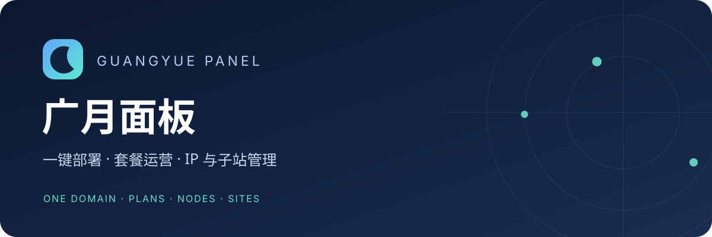

# Guangyue Panel · 广月面板

**Un dominio. Planes, nodos y sitios en una sola consola.**

Panel autohospedado para servicios proxy y recursos de red. Despliega VLESS Reality/Vision y Hysteria 2, administra salidas IP y sitios independientes, y ofrece suscripciones según el plan de cada usuario. Desarrollado con Go y Vue 3: Lite para un sitio autónomo y Pro para la gestión centralizada de varios sitios.

[](https://github.com/wudi000888-svg/guangyue-panel/releases/latest)
[](https://github.com/wudi000888-svg/guangyue-panel/actions/workflows/ci.yml)
[](LICENSE)

<!-- language-navigation -->
[简体中文](README.md) · [English](README_EN.md) · [فارسی](README.fa_IR.md) · [العربية](README.ar_EG.md) · [Español](README.es_ES.md) · [Русский](README.ru_RU.md) · [Türkçe](README.tr_TR.md)
<!-- /language-navigation -->

[Instalación](docs/INSTALL.md) · [Documentación](docs/README.md) · [Versiones](https://github.com/wudi000888-svg/guangyue-panel/releases) · [Guía de uso](docs/USER_GUIDE.md) · [Informar de un problema](https://github.com/wudi000888-svg/guangyue-panel/issues/new/choose)

## Primeros pasos

Prepara un servidor y un dominio. El asistente comprueba el entorno y configura el panel, los núcleos proxy, los certificados y la base de datos necesaria. **Docker es la opción predeterminada; también puedes elegir una instalación nativa con systemd.** El panel y los nodos predeterminados pueden compartir un dominio.

- Apunta el dominio directamente al servidor y **desactiva el proxy de CDN**. En Cloudflare, selecciona **DNS only**, sin la nube naranja.
- Los puertos públicos **TCP 443 y UDP 443** deben estar libres y permitidos en el cortafuegos y el grupo de seguridad. El instalador no cambia a otro puerto ni toma el control de servicios HTTPS existentes.
- Usa un servidor Linux completo, amd64/x86_64, con acceso root o sudo. La comprobación previa acepta Debian 12/13 y Ubuntu 22.04/24.04; las pruebas de instalación nativa en máquinas virtuales cubren Ubuntu 22.04/24.04. La aceptación del sistema no significa que se hayan probado todas sus configuraciones.
- Docker publica únicamente por IPv4: configura registros A sin AAAA. Para IPv6, elige la instalación nativa. Como punto de partida, reserva 1 CPU / 1 GiB para Lite o 2 CPU / 2 GiB para Pro, más espacio para datos y copias de seguridad.

Copia el bloque completo en la terminal del servidor:

```bash
gy_install_file=$(mktemp)
curl --proto '=https' --proto-redir '=https' -fsSL \
  https://github.com/wudi000888-svg/guangyue-panel/releases/latest/download/install.sh \
  -o "$gy_install_file" && sudo bash "$gy_install_file"
rm -f "$gy_install_file"
```

El asistente comprueba DNS, puertos, recursos y configuraciones existentes de Nginx/Docker antes de mostrar el plan de instalación. Los certificados se emiten y renuevan mediante TLS-ALPN-01 en TCP 443; se conserva el servicio HTTP 80 de Nginx. Los componentes y las imágenes se descargan de la versión seleccionada y se verifican con sus sumas de comprobación.

Después, consulta el archivo privado de la cuenta inicial, cambia la contraseña y prueba VLESS y HY2 con un cliente real. Configura el registro, la publicación de planes y el correo. El módulo de pagos está activado por defecto en sitios independientes, pero los canales externos requieren credenciales y configuración; al asumir el control de un sitio hijo por primera vez, sus pagos se desactivan por defecto. La compra de un plan depende de que su oferta esté publicada.

Los sitios existentes deben usar [actualización y reversión](docs/UPDATES.md), sin reinstalar sobre sus datos. La [guía de instalación](docs/INSTALL.md) explica `--check`, la continuación con `--resume` y los límites del despliegue.

## Lite o Pro

| | Lite | Pro |
| --- | --- | --- |
| Uso principal | Un sitio independiente | Un sitio principal que gestiona otros |
| Datos persistentes | SQLite | PostgreSQL |
| Caché y tareas | Caché local limitada y cola persistente | Redis y cola persistente |
| Conectarse a un sitio principal | Generar un token de sitio hijo | Generar un token al actuar como sitio hijo |
| Gestionar sitios hijos | No disponible | Importar su token de conexión |
| Instalación | Docker o systemd nativo | Docker o systemd nativo |

**El sitio hijo genera el token y Pro lo importa.** No se necesita un archivo de registro. Los tokens pueden caducar o seguir vigentes hasta su revocación. Cada sitio conserva sus administradores, cuentas, datos y servicios; el administrador local puede revocar el acceso. Consulta [ediciones](docs/EDITIONS.md) y [gestión de sitios](docs/BUSINESS-SITES.md).

## Funciones

- **Nodos y salidas IP:** VLESS Reality/Vision y HY2 locales, salidas HTTP CONNECT/SOCKS5 y suscripciones de proveedores autorizados. Las fuentes públicas y las herramientas de recopilación son opcionales.
- **Sitios hijos:** permisos, montaje de nodos, presupuestos compartidos, períodos de recuperación, uso y conexiones muestreados, además de actualizaciones compatibles desde Pro.
- **Planes y suscripciones:** grupos completos o nodos concretos dentro de cada grupo, cuota, duración y multiplicadores por plan. Un nuevo plan pausa la vigencia restante del anterior, que se reanuda según la cola de derechos.
- **Operación comercial:** pedidos, saldo, códigos de canje, reembolsos con aprobación del administrador, tickets, SMTP, EPay V1 y Stripe Checkout. Los servicios externos requieren configuración y pruebas propias.
- **Criptomonedas:** direcciones permanentes por pedido al elegir ese método, balances, direcciones con fondos, estimaciones de gas y consolidaciones autorizadas. Cobro y consolidación automáticos para los activos USDT/USDC admitidos en Ethereum, BNB Smart Chain, Plasma y Solana; configurar una L2 no implica que estos flujos estén admitidos.
- **Uso diario:** interfaz en chino e inglés, temas claro/oscuro, diseño móvil, navegación configurable, avisos, comprobaciones de nodos, restricciones por país, copias de seguridad y gestión de versiones.

Las comisiones solo se pagan después de que el administrador confirme una consolidación. El aporte automático de fondos para comisiones exige una dirección de un pedido real y un saldo **estrictamente superior a 0,1** del stablecoin seleccionado en la lista permitida. En EVM se cubre únicamente el importe que falta; Solana usa un pagador fijo de comisiones en SOL. Si se supera el límite de comisión aprobado, la operación se pausa para revisión manual.

Los recursos de sitios hijos tienen dos rutas distintas:

| Recurso | Ruta del tráfico |
| --- | --- |
| Nodos montados del sitio hijo | El cliente se conecta directamente al hijo; no pasa por el sitio principal. |
| Salidas IP del sitio hijo | El cliente se conecta al principal, que retransmite el tráfico a través de la salida IP del hijo. |

## Alcance y límites

Los paquetes actuales son para Linux amd64 con systemd. No se promete SLA, alta disponibilidad entre instancias ni conmutación automática entre sitios. Los núcleos proxy y las rutas de red determinan el rendimiento; cambiar a Pro no acelera una ruta lenta. Las estadísticas tienen intervalos de muestreo. Los cambios de nodos, multiplicadores y protocolos del plan activo se sincronizan en el servidor; la cuota, la vigencia y los derechos en cola conservan sus instantáneas. Un cliente que guarde una suscripción antigua debe actualizarla.

Los monederos integrados con Trust Wallet Core son monederos calientes para pequeños saldos operativos. El cifrado no aísla la firma de un servidor comprometido; retira los fondos periódicamente. La importación externa de xpub permite observar sin firmar desde el panel. No se afirma disponer de una auditoría de seguridad independiente. Los RPC y las cotizaciones públicas pueden fallar; una estimación no garantiza el coste final ni sustituye pruebas en la red real.

## Documentación y colaboración

| Objetivo | Guía |
| --- | --- |
| Instalar o mantener Docker | [Instalación](docs/INSTALL.md) · [Docker](docs/DOCKER.md) |
| Conectar sitios y compartir nodos | [Sitios](docs/BUSINESS-SITES.md) · [Montaje](docs/NODE_MOUNTS.md) |
| Configurar planes y cobros | [Planes](docs/PLANS.md) · [Comercio, en inglés](docs/COMMERCE_EN.md) · [Tesorería cripto](docs/CRYPTO_TREASURY.md) |
| Diagnosticar, guardar o actualizar | [Operación](docs/OPERATIONS.md) · [Actualizaciones](docs/UPDATES.md) · [Validación](docs/VALIDATION.md) |
| Contribuir o comunicar vulnerabilidades | [Contribución](CONTRIBUTING.md) · [Seguridad](SECURITY.md) |

Esta traducción presenta el proyecto; **la interfaz sigue disponible únicamente en chino e inglés**. La mayoría de los manuales técnicos detallados están en chino, con una guía de comercio también en inglés. Para informar de errores, indica versión, edición, tipo de instalación y pasos reproducibles con datos ficticios; no publiques claves, configuraciones de producción ni credenciales de suscripción.

## Licencias y distribución

Guangyue Panel usa **LGPL-3.0-only** desde 0.15.0 y conserva el [aviso MIT original](licenses/guangyue-legacy-MIT.txt). Hysteria y su parche usan MIT, Xray MPL-2.0 y Mihomo GPL-3.0; consulta [los avisos de terceros](THIRD_PARTY_NOTICES.md) para atribuciones y código fuente correspondiente. La estructura multilingüe se inspira en [3x-ui](https://github.com/MHSanaei/3x-ui).

Las versiones incluyen paquetes, instalador, imágenes Docker, sumas de comprobación e información de dependencias. Consulta [la preparación de versiones](docs/RELEASE.md). Las sumas detectan cambios o daños, pero no sustituyen la confianza en quien publica.
