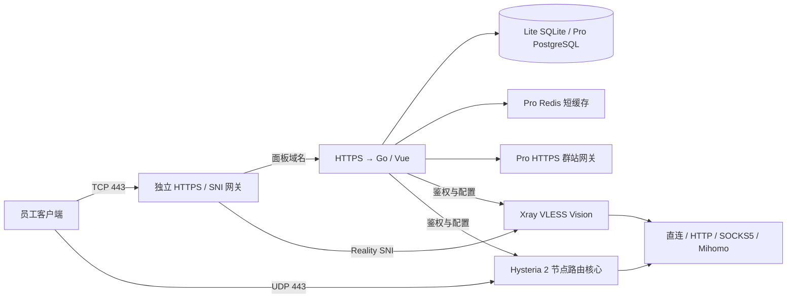

<div align="center">


# 广月面板 · Guangyue Panel

**新一代跨境电商企业级解决方案**

面向跨境电商团队的网络资源控制台，提供 Lite 独立站/子站版与 Pro 主站版：统一管理成员、节点、私有出口与独立公共代理池。

[English](README_EN.md) · [一键安装](docs/INSTALL.md) · [Docker运行](docs/DOCKER.md) · [使用手册](docs/USER_GUIDE.md) · [运维与备份](docs/OPERATIONS.md)

[月庭 Penpot 设计源](docs/designs/penpot/README.md) · [UI UX 施工方案](docs/designs/penpot-courtyard-system.md)


</div>

## 项目定位

把服务器入口、出口 IP、员工订阅和可追溯的质量检测放进一个工作台，减少跨境团队配置和切换网络资源的重复工作。采用 Go + Vue 3。Lite 使用 SQLite，Pro 使用 PostgreSQL + Redis，提供任务中心与多个 VPS 站点的集中接入和管理。

“企业级”描述团队管理与运维场景。每个站点由一个控制器独占管理；Pro 支持主控站＋业务站、统一成员授权与订阅，以及可选的邮件和在线支付接入。同站点多主高可用、组织级租户隔离与服务等级承诺不属于当前部署能力。

## 功能一览

| 模块 | 能力 |
| --- | --- |
| 套餐与倍率 | 节点 0–100×倍率、节点权限组、套餐分类与版本，手动分配/续期/周期重置，实际与配额双计量；[使用指南](docs/PLANS.md) |
| 账户与服务 | 站内余额、定额兑换码（有效期/作废）、套餐订单、退款、图片工单与内部备注；[使用指南](docs/COMMERCE.md) |
| 仪表盘 | 用户、节点、流量、出口与服务状态，快速进入常用操作 |
| 实时监控 | 管理员查看每用户 VLESS 会话、HY2 连接与实时流量曲线；约 5 秒采样，当前站点范围 |
| 客户端中心 | 6 款常见代理客户端，按系统与 CPU 架构提供官方安装入口；[使用说明](docs/LIVE-MONITORING.md) |
| 节点管理 | VLESS Reality / Hysteria 2 多用户；保留两个默认直连节点；绑定出口创建新节点；批量操作 |
| 私有 IP 池 | 独立出口 / 订阅出口 / 订阅来源分栏；HTTP CONNECT、SOCKS5、单节点和订阅导入 |
| 来源管理 | 手动更新、删除，默认每日错峰自动更新；删除来源清理独占资源及绑定节点 |
| 公共 IP 池 | 独立来源、采集策略、黑名单、并发与时限预算、定时检查；自动维护独立节点 |
| 用户与订阅 | 管理员/成员、协议权限、有效期、共享流量配额；统一订阅管理、节点来源筛选及挂载来源标注，兼容旧订阅地址 |
| 订阅体验 | Raw / Base64 / Mihomo，节点链接一键复制、二维码、成员可见质量报告 |
| IP 质量 | 多源地理位置、ASN、代理风险信号、公开页面可达性；保留来源、时间、未知和冲突 |
| DNS / IPv6 | 每节点 DNS 出口策略，安全 DoH 与 IPv6 允许/阻断选项 |
| 任务与群站 | 持久化任务队列、取消与重启恢复、配置版本；Pro 主站＋Lite/Pro 子站、统一订阅、出口分配、站点额度与远程检测 |
| 工作台 | 中文/English、主题、站内信、品牌与系统设置 |
| 运行模式 | 常规 / 无日志切换，与统一面板界面独立 |
| 部署 | 交互一键安装，默认Docker/可选原生；独立TCP443网关、HY2 UDP443、自动证书、私有状态与更新回退 |
| 版本更新 | 左上角检测并选择正式版本，后台升级、健康检查后 8 秒刷新；安装基线保护与兼容版本回退 |

> 流媒体或 AI 网站的公开页面可达，不等于账号登录、播放、支付或完整业务解锁。质量标签基于可核验的数据；不会把信息缺失强行标为“家宽”或“原生”。

## 下载版本

在 [Releases](https://github.com/wudi000888-svg/guangyue-panel/releases/latest) 的 Assets 选择 Lite（默认独立站）或 Pro（默认主站）安装包，并校验 `SHA256SUMS`。安装不需要注册文件。子站在“配对令牌”生成令牌，Pro 在“群站管理”粘贴导入，即可管理用户、节点、权限、流量与服务启停；不需要分组或预建站点。历史独立接入自动进入同一子站列表，保留本地管理员和独立运行能力。详见[子站管理](docs/BUSINESS-SITES.md)。

已有部署可按[在线更新与版本回退说明](docs/UPDATES.md)启用左上角版本管理。回退保留当前数据，不能低于安装基线；不兼容当前数据库的旧版本会被阻止。

## 快速开始

准备 **Linux amd64完整systemd服务器**；预检查白名单为Debian12/13、Ubuntu22.04/24.04，真实VM验证以该Release的CI为准，Debian白名单不等同完成原生VM验收。Lite建议1核1GiB，Pro建议2核2GiB；Docker要求Linux5.4或更新，另为其他程序、镜像和备份留余量。

1. 将1～2个域名解析到本机，关闭CDN代理；Docker当前仅IPv4，使用A记录，需要AAAA/IPv6时选择原生双栈。确认TCP443和UDP443空闲并放行，保留SSH。已有Nginx的HTTP80无需迁移。
2. 运行下面脚本，选择Lite/Pro、域名和部署方式（默认Docker、可选原生）。检测后确认计划，自动准备组件和证书。
3. 读取`/var/lib/guangyue/initial-owner.json`，以随机初始密码登录`owner`并修改密码，再验证VLESS/HY2真实连接。

```bash
gy_install_file=$(mktemp)
curl --proto '=https' --proto-redir '=https' -fsSL \
  https://github.com/wudi000888-svg/guangyue-panel/releases/latest/download/install.sh \
  -o "$gy_install_file" && sudo bash "$gy_install_file"
rm -f "$gy_install_file"
```

脚本锁定完整正式Release并校验组件及Docker镜像归档，无需GitHub/镜像仓库账号。`--check`只读检测，`--resume`按原计划续装。443占用时停止，保留其他程序与Nginx配置，默认不改宿主网络优化。详见[安装指南](docs/INSTALL.md)，旧Nginx高级路径见[旧部署指南](docs/LEGACY_INSTALL.md)。

## 邮箱与在线支付

在“系统设置 → 交易与接入”配置邮件服务与在线支付。邮件支持标准 SMTP 的 TLS/STARTTLS，提供邮箱验证、密码找回和订单通知；支付支持易支付 V1 MD5 和 Stripe Checkout，包括套餐支付、钱包充值与退款处理。新安装默认关闭这些外部服务，需填写自己的服务商凭据并检查接入。

加密钱包支持内置热 HD 钱包和外部 xpub。用户选择加密付款后自动获得专属地址，Ethereum/BSC、Solana 的白名单 USDT/USDC，以及 Plasma 的 USDT0/原生 USDC，在双 RPC 核验并最终确认后自动开通套餐。历史地址永久保存；管理员可以查看余额，在内置热钱包中通过固定 Gas 资金地址补足手续费并发起资产提取。创建钱包时选链，默认 BNB；固定 Gas 地址立即显示并可提前充值。一键启用内置独立公共 RPC 与自动人民币报价，无需填写 RPC 或汇率；预检失败保留原配置，高级手动配置保留。归集页面提供收款地址、费用预览、密码确认及余额自动刷新，Gas 费用每 5 秒查询并显示约合 USD/人民币；已有钱包可增加支持网络，Solana 使用独立 SOL 资金地址并列明代币账户租金。L2 候选网络当前只读，待核验 L1 最终性后再开放自动资金操作。详见[钱包管理](docs/CRYPTO_WALLETS.md)、[订单与归集](docs/CRYPTO_TREASURY.md)。

热钱包由官方 Trust Wallet Core 浏览器 WASM 创建，助记词由服务端 Vault 加密保存；只建议存放小额并定期转走。外部 xpub 模式不保存私钥，资产转出由外部钱包负责。生成地址或广播交易成功不等于资金最终确认。实现边界、接口和验证要求见[加密支付项目](docs/projects/crypto-payments/README.md)，长期方案见[加密支付设计](docs/CRYPTO_PAYMENTS.md)。SMTP 配置与排错见[邮件服务](docs/EMAIL.md)，法币支付接入见[交易系统](docs/COMMERCE.md)。

## 文档导航

| 文档 | 适用场景 |
| --- | --- |
| [版本选择与 Pro 部署](docs/EDITIONS.md) | Lite/Pro 对比、基础设施、迁移与群站接入 |
| [主控＋业务站](docs/BUSINESS-SITES.md) | 导入子站令牌、远程管理、启停调度、在线与流量 |
| [一键安装](docs/INSTALL.md) | 交互向导、域名与443、预检、账号和失败续装 |
| [Docker部署](docs/DOCKER.md) | Release镜像归档、隔离、持久数据、维护与回退 |
| [旧Nginx安装](docs/LEGACY_INSTALL.md) | 保留既有高级原生部署方法 |
| [使用手册](docs/USER_GUIDE.md) | 从创建用户到导入出口、发放订阅与排错 |
| [Nginx 共存](docs/NGINX.md) | 与现有 HTTPS 网站共用 TCP 443，保留自定义 SNI |
| [运维手册](docs/OPERATIONS.md) | 升级、回滚、备份恢复、续期、资源与连通性诊断 |
| [配置参考](docs/CONFIGURATION.md) | JSON 配置字段、端口、目录、运行模式 |
| [架构与边界](docs/ARCHITECTURE.md) | 数据流、权限、DNS、安全与资源设计 |
| [钱包管理](docs/CRYPTO_WALLETS.md) | 内置热钱包、外部 xpub、备份恢复、地址与资金安全边界 |
| [订单与归集](docs/CRYPTO_TREASURY.md) | 自动收款地址、历史余额、固定 Gas 地址、费用预览和提取恢复 |
| [加密支付项目](docs/projects/crypto-payments/README.md) | 当前链上支付接口、技术债、后续任务及验证门槛 |
| [开发指南](CONTRIBUTING.md) | 本地开发、测试、构建、贡献流程 |
| [安全政策](SECURITY.md) | 漏洞报告、秘密与供应链管理 |
| [第三方许可](THIRD_PARTY_NOTICES.md) | 上游来源、修改说明与再分发约束 |
| [变更记录](CHANGELOG.md) | 版本变更 |
| [发布准备](docs/RELEASE.md) | 构建产物、公开发布与版本验收 |

## 架构



网站 HTTP/2 与 Hysteria 2 是不同概念。VLESS 使用 Reality + Vision + TCP，HY2 使用 QUIC/UDP；Linux BBR 不直接控制 HY2 的 QUIC 拥塞控制。

## 来源与致谢

本项目由 [fake-ui](https://github.com/wudi000888-svg/fake-ui) 2.3.1 的部署与控制台实践发展而来，当前发布的是重新整理的 Go/Vue 双版本，**不是原版 fake-ui 2.3.1 的重打包**。保留原项目 MIT 版权声明。

文档组织和专业控制台分区参考 [Sub2API](https://github.com/Wei-Shaw/sub2api)；没有复制其产品标识、截图或文案。感谢 Xray、Hysteria、Mihomo、Go、Vue 与 SQLite 生态。

面板源码自 0.15.0 使用 [LGPL-3.0-only](LICENSE)，配套 [GPL-3.0 文本](licenses/GPL-3.0.txt)和[历史 MIT 声明](licenses/guangyue-legacy-MIT.txt)随项目提供。Hysteria 修改补丁使用 MIT；Xray 和 Mihomo 分别适用 MPL-2.0 与 GPL-3.0，详见第三方许可。

子站节点挂载与统一订阅的使用及兼容说明见 [节点挂载](docs/NODE_MOUNTS.md)。
