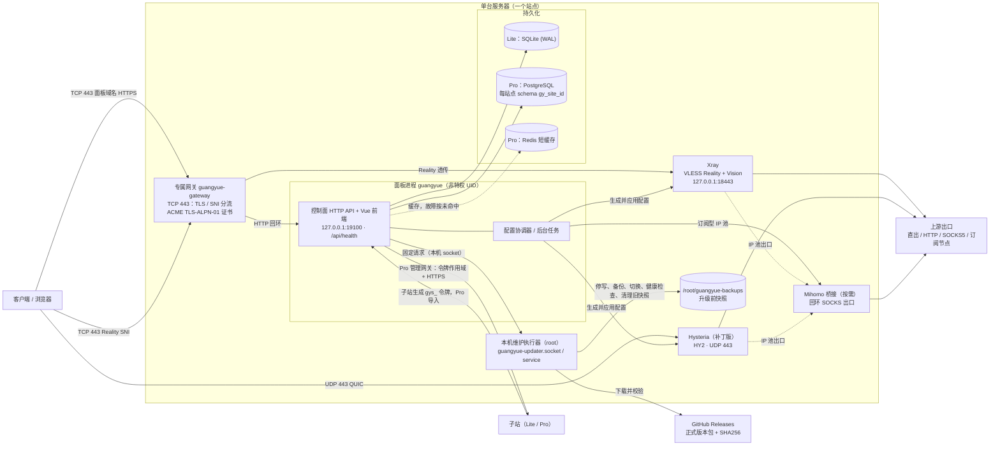

# 架构与边界

广月面板由 Go 控制面、Vue 3 前端和独立代理核心组成。控制面管理用户、套餐、资源、订单和站点；Xray / Hysteria 执行代理转发。Lite 使用 SQLite，默认独立运行；Pro 使用 PostgreSQL + Redis，默认提供主站入口。版别选择见 [Lite 与 Pro](EDITIONS.md)。

0.41.0 起，新安装通过同一个向导选择 Docker 或原生 systemd，默认 Docker。两种方式都使用专属网关，固定公开 TCP / UDP 443，自动申请证书；原有 Nginx stream 部署保留既有更新路径。详细要求见 [一键安装](INSTALL.md)，容器边界见 [Docker 部署](DOCKER.md)。

## 组件总览

下图为 0.41.0 起专属网关部署的组件与主要连接（原生 systemd 与 Docker 拓扑相同：Docker 中网关与 Postgres / Redis 为独立容器，面板与三个核心在同一面板容器内）。旧 Nginx stream 部署以宿主 Nginx 代替网关，见 [Nginx 指南](NGINX.md)。

- **入口**：网关独占 TCP 443，按 SNI 将面板域名终止为 HTTPS 并转给回环面板，Reality SNI 原样转给 Xray；HY2 直接监听 UDP 443。
- **数据**：Lite 使用本机 SQLite；Pro 以 PostgreSQL 为事实来源，Redis 只做短缓存。
- **群站**：子站生成管理令牌，由 Pro 主站导入；主站经管理网关调用子站固定接口，子站保留本地账号与独立运行能力。
- **维护**：Web 进程不持有 root 权限，版本操作经本机 socket 交给 root 维护执行器，过程与备份清理见 [更新与回退](UPDATES.md)。

## 从用户操作到代理转发

1. 前端通过受鉴权 API 提交套餐、节点或资源变更。
2. 控制面验证权限、版本与资源约束，在数据库事务中更新业务状态。
3. 配置协调器生成期望配置，由部署适配器应用到本机核心；子站配置通过经过认证的站点协议同步。
4. 核心回传流量和会话统计，控制面按节点倍率、套餐与站点预算计量。

配置 hash 排除计数和检测元数据。授权、节点路由或凭据变化产生新期望版本，成功应用后记录已应用版本；定期核对用于处理核心重启与外部故障。界面保存成功不等于远端核心已经同步，应用状态需要分别确认。

## 站点与资源

Pro 从 [群站管理](BUSINESS-SITES.md) 导入子站生成的管理令牌，无需注册文件、预建分组或拆分“独立站点”入口。子站保留本地账号、数据与独立运行能力；本地管理员可以撤销连接。长期连接凭据加密保存，令牌可设有效期或永久有效。

子站资源分为两条数据路径：挂载的子站节点由客户端直连子站；子站 IP 池则作为主站节点的出口，流量仍经过主站。主站管理、订阅授权与实际代理转发不是同一条链路。套餐、节点组及计量规则见 [套餐与节点倍率](PLANS.md)。

早期主动拉取配置的轻量业务站继续保留历史维护路径。它使用本地 SQLite、独立密钥和授权租约，不保存主站资金或工单数据；说明见 [旧业务站部署](BUSINESS-SITES-LEGACY.md)。该路径不代表当前子站必须使用注册文件。

## 代码组织

| 目录 | 职责 |
| --- | --- |
| `backend/main.go` | 启动入口与控制面装配 |
| `backend/internal/controlplane` | HTTP 处理器、应用服务、业务状态与加密仓储 |
| `backend/internal/domain` | 账户、凭据和可用性规则，无 HTTP / SQL / 核心进程依赖 |
| `backend/internal/persistence` | SQL 方言、连接预算、事务、迁移、快照与控制器租约 |
| `backend/internal/jobs` | 持久任务、容量、恢复、去重、超时、取消与保留策略 |
| `backend/internal/cache` | 本地 / Redis 短缓存、站点前缀、容量与降级 |
| `backend/internal/httpapi` | 跨站请求契约、授权范围、传输和响应限制 |
| `backend/internal/coreprocess` | 核心进程身份、状态、重启与运行适配 |
| `backend/internal/ingressgateway` | 新部署的 HTTPS、Reality 分流与 ACME 入口 |
| `frontend/src/pages` | Vue Router 懒加载页面 |
| `frontend/src/stores`、`composables`、`components` | 权限与偏好、请求生命周期、共享交互组件 |
| `deploy` | 一键安装、部署身份、证书、更新、恢复与运行适配器 |

当前业务服务仍集中在同一控制面包，共享事务与资源锁。这有利于一致性，也增加跨模块改动的回归成本。继续拆分时应先明确订单、权益、资金、资源和群站边界，保留必要事务语义，避免复制两套业务逻辑或为每次 SQL 调用增加空抽象。

前端分层、路由、状态管理、缓存与后台调度参考过 Sub2API 的组织方式；没有引入其 API 中转业务或复制其业务源码。

## 持久化、缓存与任务

SQLite 使用 WAL 和单连接。Pro 默认每站点 8 个 PostgreSQL 连接，业务表保存在 `gy_<site_id>` schema；schema 分隔不替代数据库角色权限。迁移按顺序记录 SHA256，未知迁移或校验不符会拒绝启动。AES-GCM 凭据的主密钥存于站点文件中，数据库备份必须与主密钥配套保存。

PostgreSQL 是 Pro 的持久化事实来源，Redis 只缓存仪表盘等短期结果。缓存键包含站点、权限、时间范围及运行模式版本；Redis 故障按未命中处理，无日志模式绕过仪表盘历史缓存。前端轻量状态约每 10 秒轮询，全量资源约每 60 秒或操作后刷新，离开页面后停止对应请求。

后台任务持久化并去重，恢复时重新验证权限与资源版本。来源更新错峰执行并在失败后退避；重型测速 / 采集保留单任务预算，避免争抢业务带宽。外部任务允许重试，其执行语义不能直接用作支付“恰好一次”保证。

## 入口、协议与出口

新部署的专属网关独占 TCP 443：面板域名进入 HTTPS，Reality SNI 分流至 Xray，TLS-ALPN-01 用于证书申请和续期；HY2 独占 UDP 443。Docker 当前仅发布 IPv4，原生支持双栈。两者均不接管现有 Nginx 的 HTTP 80。历史 Nginx 分流结构见 [Nginx 指南](NGINX.md)。

VLESS 使用 Reality + Vision + TCP，HY2 使用 QUIC。Linux TCP BBR 与 HY2 的拥塞控制相互独立；新一键部署默认保留宿主网络参数。

[Hysteria 补丁](../core-patches/README.md)在鉴权成功后按不可变逻辑节点选择出口，未知节点拒绝连接，TCP 与 UDP 使用同一路由；TLS、QUIC 与拥塞控制继承固定上游。HTTP / SOCKS5 直出与 Mihomo 桥接沿用节点出口规则，固定业务出口不会随测速结果自动漂移。

每节点可设 DNS 策略及 IPv6 允许 / 阻断。DoH 通过选定出口；上游是否支持 UDP / IPv6 仍需实测。用户订阅由当前生效套餐决定，公网资源与高级功能的管理分类不会自动扩大成员权限。

## 权限、维护与恢复

后端强制校验站点管理员和成员权限；前端守卫只决定导航可见性。Pro 管理网关限制令牌作用域、固定路由、HTTPS、公网地址、重定向和请求大小，不转发 Cookie，远端身份不符时拒绝连接。

更新由独立本机维护执行器完成，Web 进程保持非特权。版本事务未提交时暂停业务写入和后台任务，持久维护标记跨重启保留；确认运行版本与恢复状态后才重新放行。

备份先形成一致快照，恢复在暂存目录验证密钥、迁移和生成配置；Pro 升级另存专属 schema dump。跨文件与数据库替换不具备整机断电原子性，故障时保留私有现场与人工恢复资料。操作步骤见 [运维指南](OPERATIONS.md) 与 [更新与回退](UPDATES.md)。

## 历史数据边界

0.20.0 引入套餐与倍率，0.21.0 引入余额、订单与图片工单及迁移 005。之后各版继续调整权益与节点授权模型；这些版本号仅标记历史引入时间，不表示当前仍采用当时界面或允许任意降级。当前规则见 [套餐指南](PLANS.md) 与 [账户服务](COMMERCE.md)，数据库兼容性以本机更新器校验为准。
